# cde4301-fsae-simulator-26-27
CDE4301 FSAE Race Car Simulator 26/27 Interim Report
<html lang="en"><head><meta charset="utf-8"><meta name="viewport" content="width=device-width,initial-scale=1">NUS FSAE Simulator | CDE4301<meta name="description" content="CDE4301 NUS Formula SAE race car simulator design and interim documentation">
</head><body>
<strong>NUS FORMULA SAE</strong> CDE4301 · AY2026/27
<header class="hero">
ENGINEERING CAPSTONE · INTERIM DOCUMENTATION
<h1>FSAE Race Car Simulator</h1>
Design and development of a modular, adjustable simulator to support driver training and reproduce Formula SAE cockpit geometry.
SolidWorks CADStructural FEADesign & validation</header>
<aside><h2>Explore the report</h2><a href="#executive-summary">Executive Summary</a><a href="#introduction">Introduction</a><a href="#existing-system-analysis">Existing System Analysis</a><a href="#engineering-research-and-benchmarking">Engineering Research and
Benchmarking</a><a href="#cad-modelling-and-design-development">CAD Modelling and Design
Development</a><a href="#cad-engineering-validation-and-testing">CAD Engineering
Validation and Testing</a><a href="#future-work">Future Work</a><a href="#acknowledgements">Acknowledgements</a></aside><article><body>
<blockquote>

<strong>CDE4301 – FSAE Race Car Simulator</strong>

</blockquote>

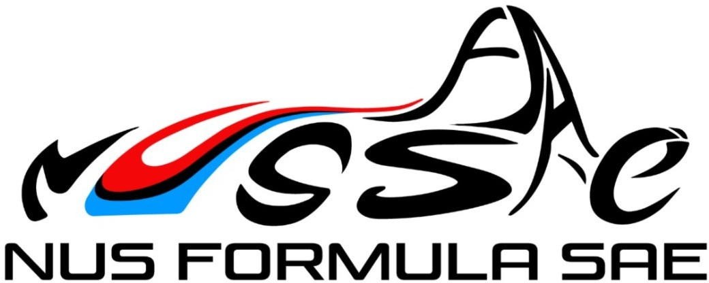

<blockquote>

<strong>CDE4301 Report</strong>

<strong>AY2026/27</strong>

<strong>Submitted by</strong>

Harith Raiyan, A0271898H

Abdul Haseeb Jamal, A0272118J

Neo Wei Yang, A0271842A

<strong>Supervisor</strong>

Lim Hong Wee

</blockquote>
<h1 class="unnumbered chapter" id="acknowledgements">Acknowledgements</h1>
<blockquote>

Our team would like to express our deepest gratitude to our project
supervisor, Professor Lim Hong Wee, for his invaluable guidance, support
and constructive feedback throughout the development of this project.
His expertise and insights have been instrumental in guiding our design
decisions, overcoming technical challenges and refining our approach to
the project. We are sincerely grateful for his patience and
encouragement, which have greatly contributed to our learning experience
and the progress of this project thus far.

</blockquote>
<h1 class="unnumbered chapter" id="executive-summary">Executive Summary</h1>
<blockquote>

This project aims to redesign and develop an FSAE race car simulator
for the NUS Formula SAE team, providing a realistic and accessible
platform for driver training. As physical track testing is often limited
by vehicle availability, maintenance, weather conditions and track
access, the simulator offers a controlled and repeatable environment to
complement real-world driving.

The previous simulator presented several limitations, including
excessive weight, restricted adjustability and difficulties in component
mounting and maintenance. To address these issues, the current project
focuses on developing a lightweight, modular and structurally rigid
simulator that closely replicates the actual FSAE cockpit geometry while
accommodating different drivers.

The simulator comprises four main subsystems: the frame, steering
system, pedal assembly, and seat and harness arrangement. Aluminium
T-slot extrusion was selected for its modularity and ease of assembly,
while SolidWorks was used to develop and integrate the CAD designs.
Preliminary structural validation was conducted through static Finite
Element Analysis (FEA) of the steering support under push and pull
loads.

Moving forward, the project will focus on further engineering
analysis, fabrication and performance validation, with integration into
the existing DOF Reality motion platform. Ultimately, the project aims
to deliver a practical, adjustable and reliable simulator that enhances
FSAE driver training and supports future development.

<strong>Table of Contents</strong>

</blockquote>

<a href="#acknowledgements">Acknowledgements 1</a>

<a href="#executive-summary">Executive Summary 2</a>

<a href="#list-of-figures">List of Figures 5</a>

<a href="#list-of-tables">List of Tables 6</a>

<a href="#list-of-abbreviations">List of Abbreviations
7</a>

<a href="#introduction">1. Introduction 8</a>

<a href="#problem-scope">1.1 Problem Scope 8</a>

<a href="#technical-review">1.2 Technical Review
9</a>

<a href="#motivation-for-an-fsae-race-car-simulator">1.3 Motivation
for an FSAE Race Car Simulator 10</a>

<a href="#existing-system-analysis">2. Existing System Analysis
11</a>

<a href="#existing-simulator">2.1 Existing Simulator
11</a>

<a href="#limitations-of-existing-simulator">2.2 Limitations of
Existing Simulator 13</a>

<a href="#identified-constraints">2.3 Identified Constraints
14</a>

<a href="#fsae-requirements-study">2.4 FSAE Requirements Study
15</a>

<a href="#interview-findings">2.5 Interview Findings
17</a>

<a href="#engineering-research-and-benchmarking">3. Engineering
Research and Benchmarking 18</a>

<a href="#simulator-benchmarking">3.1 Simulator Benchmarking
18</a>

<a href="#engineering-design-specifications">3.2 Engineering Design
Specifications 19</a>

<a href="#concept-generation">3.3 Concept Generation
19</a>

<a href="#initial-design-concept">3.4 Initial Design Concept
25</a>

<a href="#motion-rig-frame-reference">3.5 Motion Rig Frame Reference
25</a>

<a href="#frame-concept-research">3.6 Frame Concept Research
26</a>

<a href="#concept-design">3.7 Concept Design 28</a>

<a href="#cad-modelling-and-design-development">4. CAD Modelling and
Design Development 28</a>

<a href="#frame-cad-design">4.1 Frame CAD Design
29</a>

<a href="#steering-system-cad-development">4.2 Steering System CAD
Development 30</a>

<a href="#pedal-assembly-cad-development">4.3 Pedal Assembly CAD
Development 32</a>

<a href="#seat-and-harness-cad-development">4.4 Seat and Harness CAD
Development 33</a>

<a href="#complete-simulator-assembly">4.5 Complete Simulator
Assembly 34</a>

<a href="#cad-engineering-validation-and-testing">5. CAD Engineering
Validation and Testing 36</a>

<a href="#axial-pushpull-force-simulation-analysis">5.1 Axial
Push/Pull Force Simulation Analysis 36</a>

<a href="#axial-pushpull-force-simulation-analysis-1">5.2 Axial
Push/Pull Force Simulation Analysis 37</a>

<a href="#torsion-stress-simulation-analysis">5.3 Torsion Stress
Simulation Analysis 38</a>

<a href="#future-work">6. Future Work 39</a>

<a href="#future-testing">6.1 Future Testing 39</a>

<a href="#project-timeline">6.2 Project Timeline
39</a>

<h1 class="unnumbered chapter" id="list-of-abbreviations">List of
Abbreviations</h1>
<table class="data-table">
<colgroup>
<col style="width: 50%"/>
<col style="width: 49%"/>
</colgroup>
<thead>
<tr class="header">
<th><strong>Abbreviation</strong></th>
<th><strong>Definition</strong></th>
</tr>
</thead>
<tbody>
<tr class="odd">
<td>AI</td>
<td>Artificial Intelligence</td>
</tr>
<tr class="even">
<td>CAD</td>
<td>Computer-Aided Design</td>
</tr>
<tr class="odd">
<td>DOF</td>
<td>Degrees of Freedom</td>
</tr>
<tr class="even">
<td>MotionRig</td>
<td>Ergonomics Jig on Motion Simulator Rig</td>
</tr>
<tr class="odd">
<td>MotionSim</td>
<td>Motion Simulator Rig</td>
</tr>
<tr class="even">
<td>R26e</td>
<td><blockquote>

NUS Formula SAE 2026 race car

</blockquote></td>
</tr>
</tbody>
</table>

Table A: List of
Abbreviations

<h1 class="chapter" id="introduction">Introduction </h1>
<blockquote>

<em>Prepared by: Harith Raiyan, Abdul Haseeb, Neo Wei Yang</em>

In FSAE, driver performance plays a crucial role in achieving
competitive results. Developing driver familiarity requires consistent
practice in braking, steering, throttle control and racing techniques.
However, physical testing is often limited by vehicle availability,
weather conditions, track access and safety considerations.

A simulator provides a controlled and repeatable environment that
complements physical track testing. Professional motorsport teams, such
as Formula 1, utilise Driver-in-the-Loop simulators for driver
preparation, circuit familiarisation and vehicle development. These
systems demonstrate the potential of simulation to enhance driver
training while reducing reliance on physical track sessions.

</blockquote>
<h2 class="section-heading" id="problem-scope">Problem Scope</h2>
<blockquote>

Driver training in FSAE is limited by vehicle availability, charging
requirements, maintenance, weather conditions and restricted track
access. These constraints reduce opportunities for consistent practice,
highlighting the need for a simulator that provides a controlled and
repeatable training environment.

The previous FSAE simulator combined ergonomic assessment and driving
simulation using an existing monocoque. However, its design introduced
limitations such as excessive weight, restricted component
adjustability, mounting difficulties and challenges in maintenance and
future modifications.

Therefore, this project aims to redesign the simulator into a
practical, realistic and modular driver-training platform. The new
design prioritises structural rigidity, secure component mounting,
driver adjustability and ease of maintenance, while considering future
integration with the existing motion platform.The project therefore
addresses the following central problem:

</blockquote>

<em><strong>How can the existing NUS FSAE simulator be redesigned for
improved functionality, usability and future
integration?</strong></em>

<h2 class="section-heading" id="technical-review">Technical Review</h2>
<blockquote>

The project will initially focus on the three primary driver
interfaces:

</blockquote>
<ol type="1">
<li>
<strong>Brake &amp; throttle pedals </strong>– developing a more
realistic pedal system, including a hydraulic braking system
representative of the actual race car.
</li>
<li>
<strong>Frame &amp; Steering wheel </strong>– integrating the
actual FSAE steering wheel and improving its position and packaging to
provide a realistic steering experience without obstructing driver leg
and knee movement.
</li>
<li>
<strong>Seat &amp; Harness</strong> – developing an adjustable
and rigid seating system that can accommodate different drivers while
maintaining the relevant cockpit geometry.
</li>
</ol>
<blockquote>

Following the completion of these core systems, the project will
investigate the development of a dedicated simulator chassis and
integration with the existing motion platform. The LCD display and
motion-rig integration will therefore be treated as subsequent
developments, ensuring that the fundamental driver interfaces are
completed first.

</blockquote>
<table class="data-table">
<colgroup>
<col style="width: 24%"/>
<col style="width: 37%"/>
<col style="width: 37%"/>
</colgroup>
<thead>
<tr class="header">
<th><strong>Name</strong></th>
<th><strong>Initial Phase</strong></th>
<th><strong>Final Phase</strong></th>
</tr>
</thead>
<tbody>
<tr class="odd">
<td>Harith</td>
<td>Frame &amp; Steering Wheel</td>
<td rowspan="2">Motion Rig</td>
</tr>
<tr class="even">
<td>Haseeb</td>
<td>Throttle Brake &amp; Pedals</td>
</tr>
<tr class="odd">
<td>Wei Yang</td>
<td>Seat &amp; Harness</td>
<td>LCD Screen</td>
</tr>
</tbody>
</table>

Table B: Individual
Roles in NUS Formula SAE Race Car Simulator

<h2 class="section-heading" id="motivation-for-an-fsae-race-car-simulator">Motivation for an
FSAE Race Car Simulator</h2>
<blockquote>

<strong><u>Increasing Driver Training Availability</u></strong>

A major motivation for the simulator is to increase driver training
opportunities without relying on the physical race car. Unlike
conventional internal-combustion vehicles, electric FSAE cars require
charging and thermal-management procedures between operating sessions,
limiting available driving time. The simulator therefore provides an
alternative training environment when the physical vehicle is
unavailable.

Rather than replacing real-world testing, the simulator complements
track sessions by allowing drivers to repeatedly practise fundamental
driving skills before applying them in the actual race car.

<strong><u>Training Under Unfavourable Conditions</u></strong>

Physical track testing is dependent on environmental conditions, such
as rain, poor visibility and unsuitable track conditions, which may
disrupt training sessions. A simulator provides a controlled environment
for uninterrupted training, allowing drivers to repeatedly practise
different driving scenarios without the variability of real-world
conditions.

<strong><u>Repetition and Scenario-Based Training</u></strong>

One of the key advantages of simulation is the ability to repeatedly
practice specific corners, braking zones and racing lines while
comparing performance between attempts. This is particularly beneficial
in FSAE, where actual driving opportunities are limited. The simulator
allows drivers to familiarise themselves with circuit layouts and
improve driving consistency before physical track sessions.

<strong><u>Pre-Event and Circuit Familiarisation</u></strong>

Simulation is widely used in professional motorsport, with Formula 1
teams utilising Driver-in-the-Loop simulators for circuit
familiarisation, driver preparation and vehicle setup evaluation.
Similarly, FSAE simulators allow drivers to familiarise themselves with
circuit layouts, braking zones and driving characteristics before
physical track sessions, making better use of limited testing
opportunities.

</blockquote>
<h1 class="chapter" id="existing-system-analysis">Existing System Analysis </h1>
<blockquote>

<em>Prepared by: Harith Raiyan, Abdul Haseeb, Neo Wei Yang</em>

The redesign of the simulator will follow a user-centred engineering
design approach. As the primary users of the simulator are members and
drivers of the NUS FSAE team, their requirements will form an important
basis for determining the design direction. Two forms of investigation
will therefore be undertaken:

</blockquote>
<ol type="1">
<li>
<strong>User-based investigation</strong> – understanding the
requirements, problems and preferences of the FSAE team.
</li>
<li>
<strong>Engineering investigation</strong> – assessing the
existing simulator and researching possible technical
solutions.
</li>
</ol>
<blockquote>

The findings from both investigations will subsequently be translated
into engineering design requirements.

</blockquote>
<h2 class="section-heading" id="existing-simulator">Existing Simulator</h2>
<blockquote>

The existing NUS FSAE simulator was developed as part of previous
work during which the team acquired a DOF Reality HERO 3 Universal
Motion platform to provide motion feedback and enhance the realism of
the driving experience.

As the motion platform has already been purchased, the current
project must take the existing system into consideration. This
introduces several design constraints, particularly in terms of the
simulator frame's dimensions, weight distribution, mounting points, and
structural compatibility. Furthermore, the limited project budget makes
replacing the existing motion platform impractical.

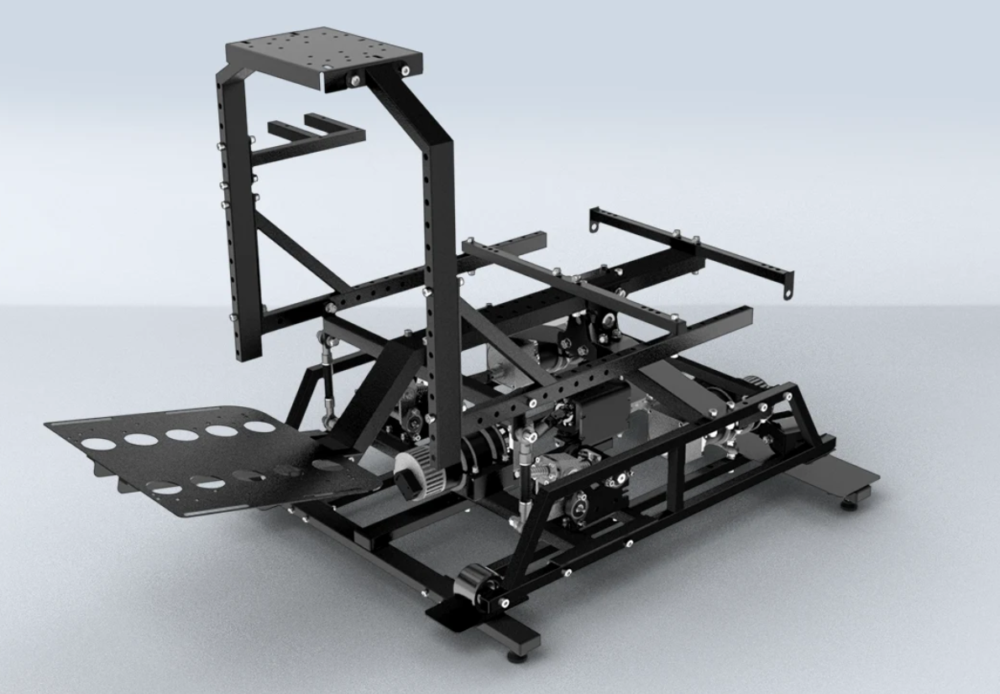

</blockquote>

Figure 1: Existing DOF
Reality motion platform acquired by the previous FYP team (DOF Reality
HERO 3)

<blockquote>

Alternative motion systems, such as the D-BOX four-actuator motion
platform, are also available. These systems utilise independently
controlled actuators positioned at different corners of the simulator to
provide motion feedback. While such systems might offer a much better
approach for us due to our long structure, their significantly higher
costs make them less feasible within the project's budget.

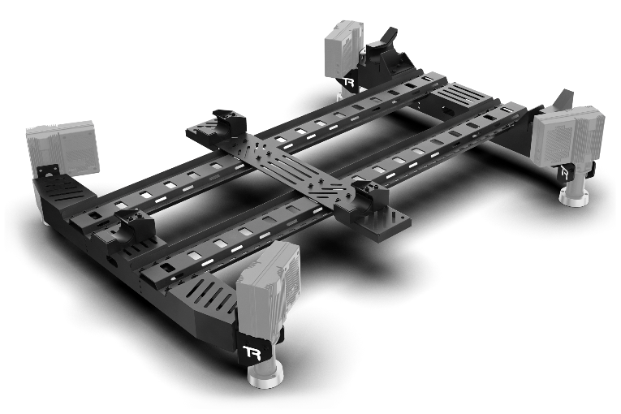

</blockquote>

Figure 2: Example of a
D-BOX four-actuator motion simulator for comparison

<blockquote>

The primary objective of this project is to develop a rigid,
adjustable and ergonomically suitable simulator frame that closely
replicates the FSAE driving position. The design prioritises structural
rigidity, driver adjustability and ergonomics, allowing the simulator to
function independently as a stationary setup while accommodating
potential integration with the existing DOF Reality motion platform.

</blockquote>
<h2 class="section-heading" id="limitations-of-existing-simulator">Limitations of Existing
Simulator</h2>
<blockquote>

The previous simulator provided a useful platform for ergonomic
testing and simulation. However, its design was influenced by the need
to serve both ergonomic assessment and simulator functions. The present
project has identified several areas that can potentially be
improved.

<strong><u>Frame</u></strong>

The existing structure is relatively heavy and occupies a significant
amount of space. Its construction around an existing monocoque also
limits the flexibility available for modifying component locations.

<strong><u>Component Mounting</u></strong>

The mounting of individual components is another area requiring
investigation. The seat, pedals and steering system should each have
secure mounting interfaces while allowing adjustment where
necessary.

The new design should avoid unnecessary extensions or complicated
mounting arrangements that could introduce unwanted movement or make
maintenance difficult.

<strong><u>Driver Interfaces</u></strong>

The seat, pedals and steering wheel form the main physical interfaces
between the driver and simulator. These components therefore have a
direct influence on how representative the simulator is of the actual
FSAE vehicle.

The redesign will investigate whether these components can be
positioned and mounted to more closely reproduce the actual race-car
configuration.

<strong><u>Future Development</u></strong>

The simulator should not be designed as a closed system. Future
additions such as an LCD display and motion platform may require
additional mounting interfaces.

</blockquote>
<h2 class="section-heading" id="identified-constraints">Identified Constraints</h2>
<blockquote>

Several constraints that will shape the design came out of reviewing
the existing simulator, the previous FYP work and the FSAE requirements.
They set the limits that the frame, driver interfaces and mounting
arrangements must be designed within.

<strong><u>DOF Reality H3 platform</u></strong>

The previous team already bought the DOF Reality HERO 3 motion
platform, and the limited project budget rules out replacing it. The new
simulator frame must therefore be compatible with the platform’s
footprint, mounting points and centre of gravity (CG). This keeps future
motion integration possible without major structural changes.

<strong><u>Motion platform layout</u></strong>

Four-actuator motion systems, such as D-BOX, would suit a long
simulator structure better because they support the frame at several
corners. However, their much higher cost makes them impractical for this
project. The H3’s compact layout also limits the frame’s overall
dimensions: the previous team (FTS-303) had to make its rig 80 mm
narrower to fit the H3. The new frame must be sized within similar
limits.

<strong><u>Pedal and driver loads</u></strong>

The FSAE rules require the brake pedal to withstand a minimum force
of 2000 N, and forces of up to 2500 N have been measured. The pedal
assembly and its mounting structure will therefore be designed for 2500
N with a factor of safety of 2. The seat and frame must also support
drivers of up to about 100 kg without excessive deflection.

<strong><u>Driver range</u></strong>

The simulator should fit drivers from the 5th percentile female to
the 95th percentile male. The seat and pedal positions must be
adjustable across this range, so that each driver can reach a
representative driving position without changes to the main frame.

<strong><u>R26e/R27e cockpit geometry</u></strong>

To keep the driving position realistic, the simulator must replicate
the R26e cockpit geometry, including the 14.78° pedal face angle and the
43° seat recline. Both are referenced to the H-point datum. Using the
H-point as a common reference makes it possible to compare the simulator
directly with the actual vehicle and to update it for later cars such as
the R27e.

<strong><u>Harness and project</u></strong>

The harness mounting points must maintain a 125 mm separation between
the lap belt and anti-submarine belt attachments to preserve the
intended belt geometry and load paths. Additionally, the simulator will
incorporate the actual FSAE steering wheel to ensure realism. Budget and
time constraints also require practical, cost-effective material
selection and fabrication methods.

</blockquote>
<h2 class="section-heading" id="fsae-requirements-study">FSAE Requirements Study</h2>
<blockquote>

As the simulator is intended for the NUS FSAE team, consultations
with team members will be conducted to identify user requirements,
existing limitations and areas for improvement. A questionnaire will be
developed to determine the key components requiring redesign and
establish design priorities. The questions will focus on the following
areas:

</blockquote>

<em><strong>General</strong></em>

<ul>
<li>
<em>What are the main problems experienced when using the
existing simulator?</em>
</li>
<li>
<em>Which aspects should be redesigned?</em>
</li>
</ul>

<em><strong>Seat</strong></em>

<ul>
<li>
<em>What problems are experienced with the current
seat?</em>
</li>
<li>
<em>How important is seat adjustability?</em>
</li>
</ul>

<em><strong>Pedals</strong></em>

<ul>
<li>
<em>Is the current pedal position suitable for different
drivers?</em>
</li>
<li>
<em>What improvements are desired for the braking
system?</em>
</li>
</ul>

<em><strong>Steering</strong></em>

<ul>
<li>
<em>How important is the use of the actual FSAE steering
wheel?</em>
</li>
<li>
<em>Does the current arrangement interfere with driver leg or
knee movement?</em>
</li>
</ul>

<em><strong>Frame</strong></em>

<ul>
<li>
<em>What are the main problems with the existing
frame?</em>
</li>
<li>
<em>How important is the ability to modify or replace
components?</em>
</li>
</ul>

<em><strong>Future Development</strong></em>

<ul>
<li>
<em>Should the new simulator accommodate future motion-rig
integration?</em>
</li>
<li>
<em>Should the LCD display be mounted to the
simulator?</em>
</li>
<li>
<em>What future components or systems should the frame
accommodate?</em>
</li>
</ul>
<h2 class="section-heading" id="interview-findings">Interview Findings</h2>
<blockquote>

The responses will be consolidated to identify common requirements
and priorities among the FSAE team.

</blockquote>
<table class="data-table">
<colgroup>
<col style="width: 50%"/>
<col style="width: 49%"/>
</colgroup>
<thead>
<tr class="header">
<th><strong>FSAE User Findings</strong></th>
<th><strong>Design Implications</strong></th>
</tr>
</thead>
<tbody>
<tr class="odd">
<td>Actual steering wheel is preferred</td>
<td>Integrate FSAE steering wheel</td>
</tr>
<tr class="even">
<td>Different drivers require different driving positions</td>
<td>Adjustable seat and/or pedal box</td>
</tr>
<tr class="odd">
<td>More representative braking is required</td>
<td>Explore a hydraulic braking system</td>
</tr>
<tr class="even">
<td>Existing steering mounting requires improvement</td>
<td>Develop rigid steering support</td>
</tr>
<tr class="odd">
<td>Existing pedal arrangement is difficult to use or adjust</td>
<td>Modular, accessible component mounting</td>
</tr>
<tr class="even">
<td>Future compatibility</td>
<td>Consider DOF motion mounting interfaces</td>
</tr>
</tbody>
</table>

Table C: FSAE User
Findings and their Design Implication

<blockquote>

Our design priority is to achieve a balance between realism,
adjustability, structural rigidity and driver compatibility. Ultimately,
we aim to develop a simulator whose performance and functionality can be
validated through quantitative engineering measurements.

</blockquote>
<h1 class="chapter" id="engineering-research-and-benchmarking">Engineering Research and
Benchmarking</h1>
<blockquote>

Following the identification of the user and engineering
requirements, existing simulator designs and possible manufacturing
approaches will be investigated.

</blockquote>
<h2 class="section-heading" id="simulator-benchmarking">Simulator Benchmarking</h2>

<em>Prepared by: Harith Raiyan</em>

<blockquote>

Existing racing and Formula-style simulator designs will be examined
to identify relevant design approaches.

Figure 3 presents examples of static race car simulators featuring
rigid, open-frame structures that support adjustable seats, steering
wheels, pedals and displays. These designs demonstrate how essential
driver interfaces can be integrated into a compact and modular setup
without requiring a motion platform.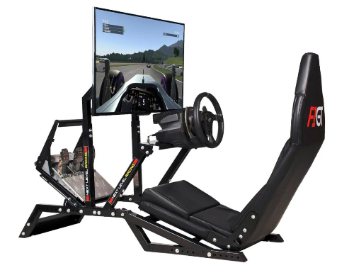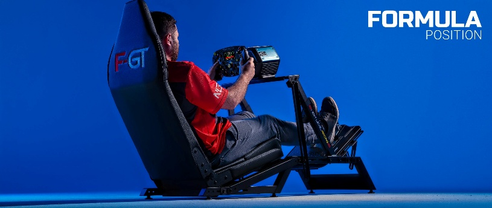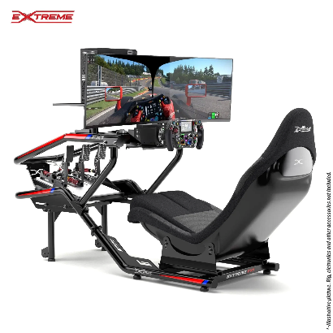

</blockquote>

Figure 3: Samples of
Race Car Simulators without Motion Rig

<blockquote>

Figure 4 presents simulators incorporating motion rigs, which require
stronger supporting structures and increase design complexity and
weight. These examples highlight the importance of designing the
simulator as a functional static platform while considering future
motion-rig integration.

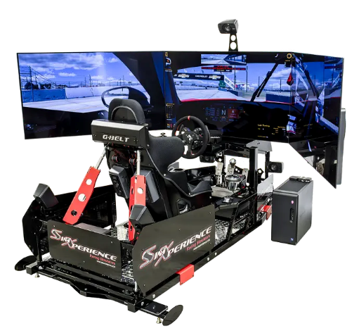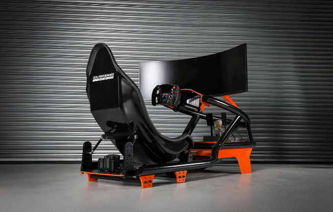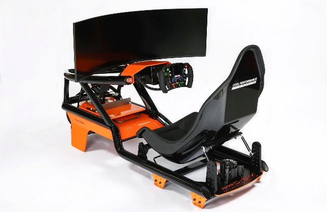

</blockquote>

Figure 4: Samples of
Race Car Simulators with Motion Rig

<h2 class="section-heading" id="engineering-design-specifications">Engineering Design
Specifications</h2>

<em>Prepared by: Harith Raiyan</em>

<blockquote>

Following the identification of user requirements and existing design
limitations, preliminary engineering specifications were established to
guide the simulator's development. These specifications aim to balance
structural rigidity, adjustability, realistic driving geometry and
driver compatibility within the project's constraints. The proposed
specifications are presented in Table D and may be refined through
further CAD development, analysis and validation.

</blockquote>
<table class="data-table">
<colgroup>
<col style="width: 36%"/>
<col style="width: 63%"/>
</colgroup>
<thead>
<tr class="header">
<th><strong>Parameter</strong></th>
<th><strong>Proposed Specification</strong></th>
</tr>
</thead>
<tbody>
<tr class="odd">
<td>Frame Dimensions (L x W)</td>
<td>1,500–1,800 mm × 400–550 mm</td>
</tr>
<tr class="even">
<td>Frame mass</td>
<td>15–30 kg (excluding mounted components)</td>
</tr>
<tr class="odd">
<td>Steering adjustment range</td>
<td>0°–60° rotation (tilt adjustment)</td>
</tr>
<tr class="even">
<td>Pedal adjustment range</td>
<td>100–200 mm longitudinally</td>
</tr>
<tr class="odd">
<td>Structural rigidity</td>
<td>Minimal visible deformation under normal driving loads</td>
</tr>
<tr class="even">
<td>Motion compatibility</td>
<td>Potential integration with existing DOF Reality platform</td>
</tr>
<tr class="odd">
<td>Budget</td>
<td>Within allocated project funding</td>
</tr>
</tbody>
</table>

Table D: Design
Specifications of Race Car Simulator

<blockquote>

Overall, these preliminary specifications establish a foundation for
the detailed CAD development and subsequent engineering validation. The
final design will be assessed against measurable criteria to determine
whether the simulator meets its intended functional and performance
requirements.

</blockquote>
<h2 class="section-heading" id="concept-generation">Concept Generation</h2>
<blockquote>

Preliminary concepts for the seat, pedals and steering wheel were
developed and evaluated based on structural performance, weight,
adjustability, manufacturability, maintenance and future compatibility.
Each component was initially designed individually before being
integrated into the overall simulator frame.

<strong><u>Steering Wheel Concepts</u></strong>

<em>Prepared by: Harith Raiyan</em>

The steering system aims to incorporate the actual FSAE steering
wheel to replicate the race car's driving experience, while providing
additional adjustability to accommodate different drivers and future
changes in FSAE vehicle configurations.

</blockquote>
<ol type="1">
<li>
<em><strong>Concept A</strong> – Rotatable Steering
Mount</em>
</li>
</ol>
<blockquote>

The steering wheel is mounted on a pivoting bracket that allows the
steering angle to be adjusted according to the driver's preference. The
mechanism consists of a fixed support bracket with a curved adjustment
slot and a rotating mounting bracket connected to the steering
wheelbase. Once the desired angle is achieved, locking bolts are
tightened to secure the steering wheel in position.

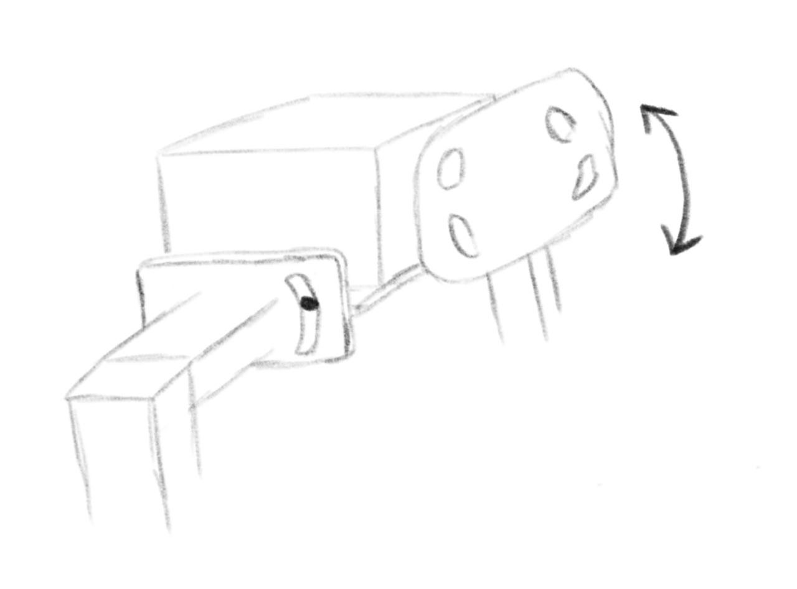

</blockquote>

Figure 5: Rough sketch
of an adjustable steering wheel angle

<blockquote>

<strong>Advantages:</strong> accommodates different driver
preferences and seating positions, improves driving ergonomics, and
allows the steering wheel angle to be adjusted without modifying the
main frame.

<strong>Considerations:</strong> additional brackets, pivot joints
and locking bolts increase assembly complexity. The locking mechanism
must provide sufficient rigidity to prevent unwanted movement or
vibrations during steering. The adjustment range must also be limited to
ensure adequate clearance and structural stability.

</blockquote>
<ol start="2" type="1">
<li>
<em><strong>Concept B</strong> – Spacer-Based
Adjustment</em>
</li>
</ol>
<blockquote>

Keeps a rigid bar like Concept A, but the hub sits on a removable
stack of spacer plates between the bar and the wheel. Add or remove
spacers to change how far the wheel sits from the driver.

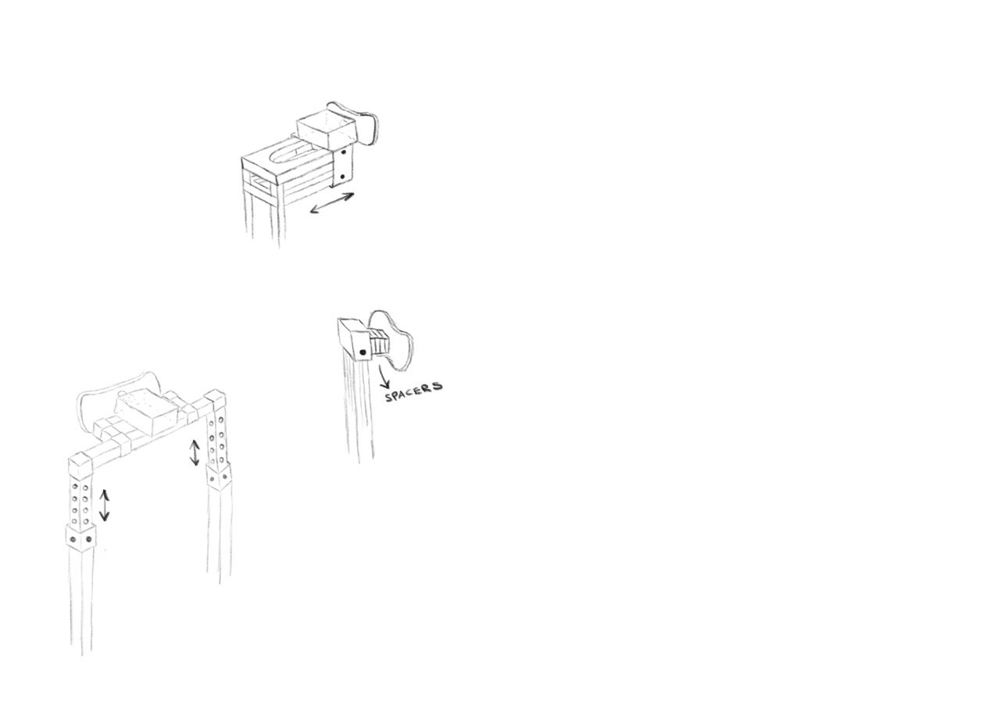

</blockquote>

Figure 6: Rough sketch
of a spacer-based adjustment steering wheel

<blockquote>

<strong>Advantages:</strong> far simpler and lighter than Concept A,
still gives coarse reach adjustment in fixed increments (e.g. 5/10/20 mm
plates), very rigid since there's no sliding joint underload.

<strong>Considerations:</strong> adjustment is stepwise, not
continuous; steering angle is still fixed; changing setup means
unbolting the hub each time, not a quick in-seat adjustment.

</blockquote>
<ol start="3" type="1">
<li>
<em><strong>Concept C</strong> – Two-rod Cantilever
Adjustment</em>
</li>
</ol>
<blockquote>

Two parallel rods run from the base up toward the driver, joined by a
cross bar that carries the wheel. A sliding clamp on each rod lets the
whole bar move up/down and toward/away from the driver, and the two-rod
(rather than single-post) layout resists twisting under steering loads
much better than one central post

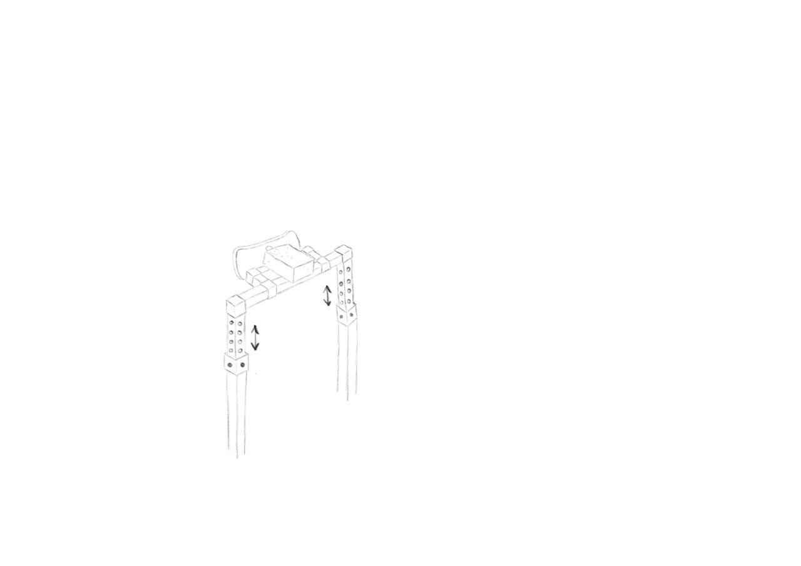

</blockquote>

Figure 7: Rough sketch
of a two-rod cantilever adjustment steering wheel

<blockquote>

<strong>Advantages:</strong> two-point support is much stiffer
against steering torque than a single post, still fully adjustable
(height + reach), and it's a design you could bolt straight onto the
existing rig's side rails without redesigning the base

<strong>Considerations:</strong> two clamps to keep synchronized and
it's a bit heavier/more parts than Concept A or B. Might rattle when the
simulator runs under a motion rig.

<strong><u>Pedal Concepts</u></strong>

<em>Prepared by: Abdul Haseeb</em>

</blockquote>
<ol type="1">
<li>
<em><strong>Concept A</strong> – Lead-Screw Pedal
Adjustment</em>
</li>
</ol>

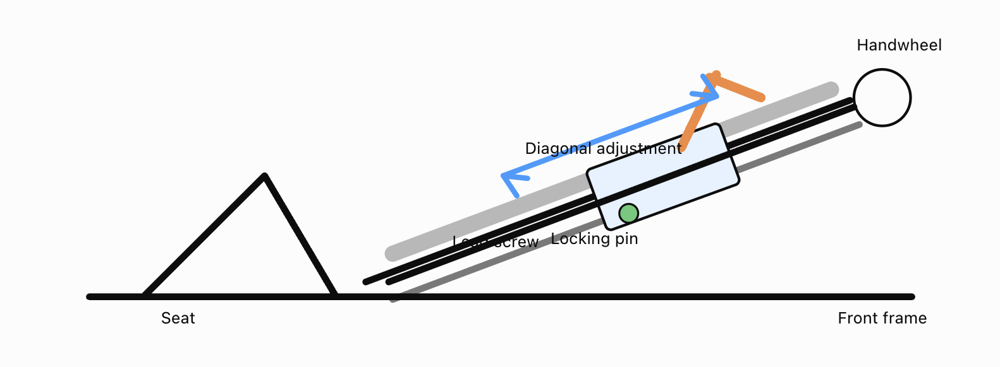

Figure 8: Rough sketch
of a lead-screw pedal adjustment

<ul>
<li>
The brake and throttle pedals are mounted together on a rigid
carriage.
</li>
<li>
The carriage moves diagonally along two inclined linear guide
rails.
</li>
<li>
A handwheel rotates a lead screw, moving the pedals
upward/forward or downward/backward.
</li>
<li>
A locking pin secures the selected position after
adjustment.
</li>
</ul>
<blockquote>

<strong>Advantages</strong>:

Smooth and precise adjustment.

Can be adjusted while the driver is seated.

Easy to return to a specific pedal position.

Pedal carriage remains properly aligned.

Suitable for frequent adjustments between drivers.

<strong>Considerations</strong>:

More expensive than the other concepts.

Requires more components, including bearings, rails and a lead
screw.

Backlash may develop in the screw mechanism.

Rails and screw require occasional maintenance.

A separate locking pin is recommended to resist heavy braking
loads.

</blockquote>
<ol start="2" type="1">
<li>
<em><strong>Concept B</strong> – Slotted-Rail Pedal
Adjustment</em>
</li>
</ol>

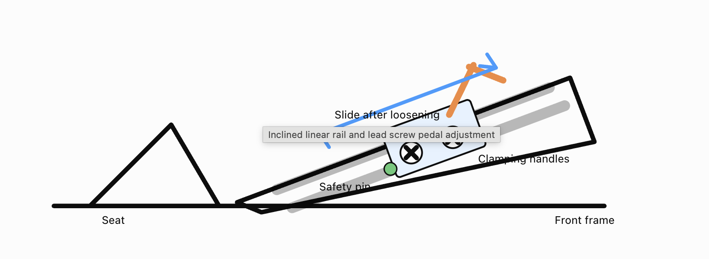

Figure 9: Rough sketch
of a slotted-rail pedal adjustment

<ul>
<li>
The pedal carriage is connected to two inclined side plates
through bolts passing inside long slots.
</li>
<li>
The driver loosens the clamping handles and slides the entire
pedal assembly diagonally.
</li>
<li>
Once positioned, the handles are tightened and a safety pin locks
the carriage.
</li>
</ul>
<blockquote>

<strong>Advantages:</strong>

Simple and relatively inexpensive.

Provides continuous adjustment instead of fixed positions.

Easy to manufacture using laser-cut or machined plates.

Requires fewer components than the lead-screw design.

Can be integrated into the existing simulator frame.

<strong>Considerations:</strong>

The pedal assembly may need to be manually supported during
adjustment.

Friction from the clamps alone may not prevent slipping.

Both sides must be adjusted evenly to avoid misalignment.

Slots and clamping surfaces may wear over time.

A safety pin or toothed locking surface should carry the brake
load.

</blockquote>
<ol start="3" type="1">
<li>
<em><strong>Concept C</strong> – Indexed-Hole Pedal
Adjustment</em>
</li>
</ol>

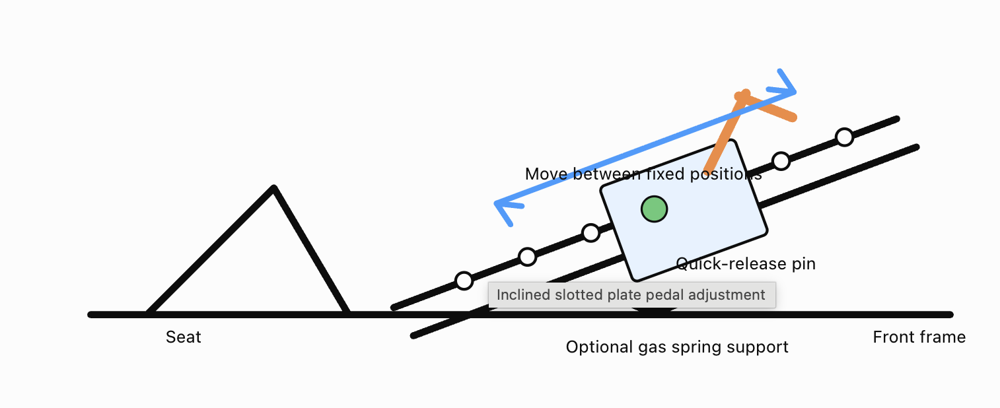

Figure 10: Rough
sketch of a indexed-hole pedal adjustment

<ul>
<li>
The pedal carriage slides along inclined guide rails.
</li>
<li>
A series of equally spaced holes provides several fixed pedal
positions.
</li>
<li>
Quick-release pins are removed before adjustment and reinserted
after the required position is selected.
</li>
<li>
The pedals move diagonally upward/forward or downward/backward
between positions.
</li>
</ul>
<blockquote>

<strong>Advantages:</strong>

Strong and highly resistant to slipping.

Simple, reliable, and inexpensive.

Provides repeatable settings for different drivers.

Easy to inspect and maintain.

Locking pins can directly resist heavy braking forces.

<strong>Considerations:</strong>

Adjustment is limited to fixed increments.

Both side pins must be correctly aligned and inserted.

Closely spaced holes may weaken the side plates.

The pedal carriage may drop when the pins are removed.

A gas spring or support handle may be needed to assist adjustment

</blockquote>
<h2 class="section-heading" id="initial-design-concept">Initial Design Concept</h2>

<em>Prepared by: Harith Raiyan</em>

<blockquote>

The overall concept will consist of:

<em>Steering System + Pedal Assembly + Seat + Supporting
Chassis</em>

At this stage, several preliminary concepts will be developed before
a detailed CAD.

</blockquote>

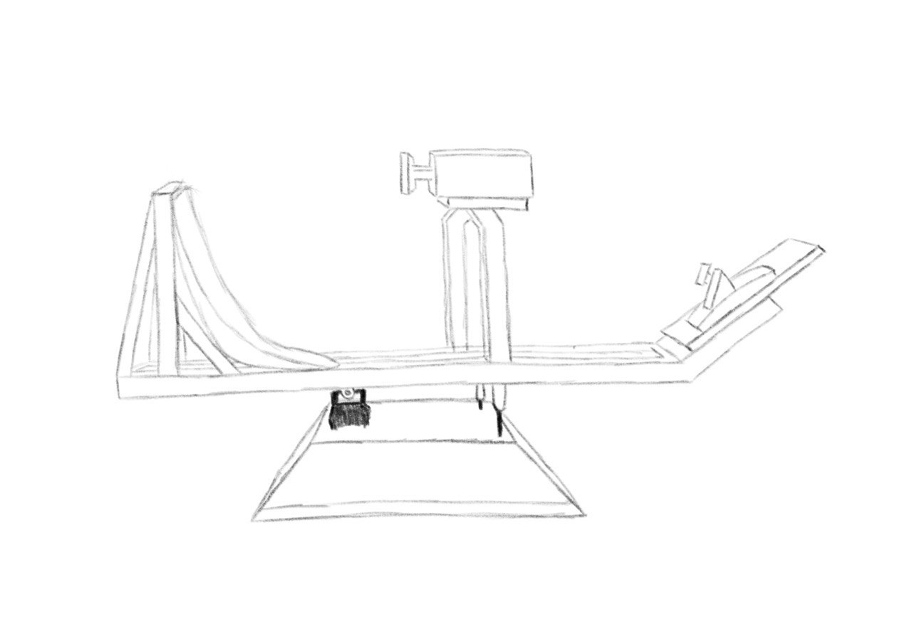

Figure 11: Rough
Sketch of Race Car Simulator

<h2 class="section-heading" id="motion-rig-frame-reference">Motion Rig Frame Reference</h2>

<em>Prepared by: Harith Raiyan, Abdul Haseeb, Neo Wei Yang</em>

<blockquote>

The DOF Reality H3 Universal Motion Platform was used as a reference
for potential future integration. Its dimensional drawings provide the
necessary information to assess the simulator's mounting requirements,
overall dimensions and compatibility with the existing motion
platform.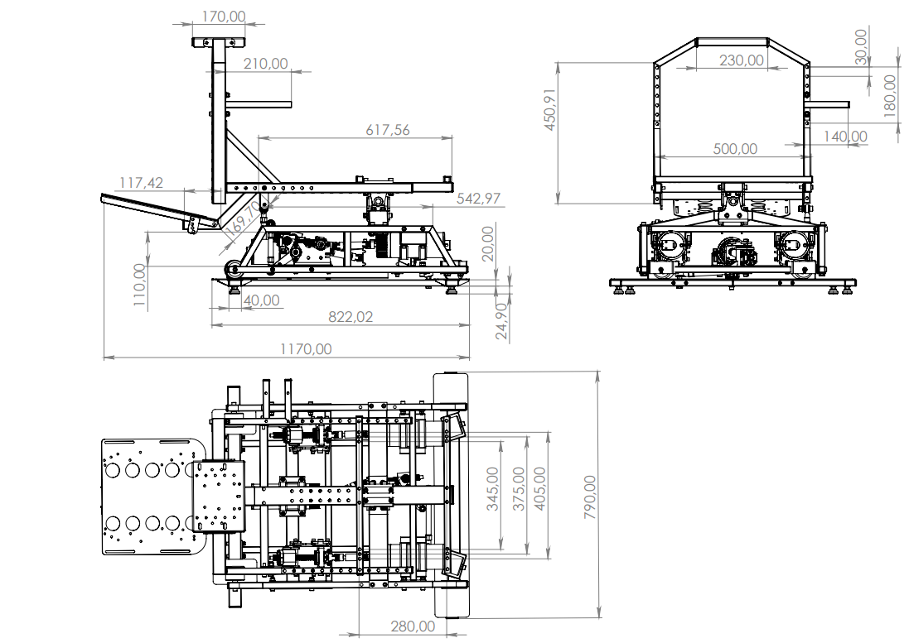

</blockquote>

Figure 12: Dimensions
of DOF Reality H3 Universal Motion Platform

<h2 class="section-heading" id="frame-concept-research">Frame Concept Research</h2>

<em>Prepared by: Harith Raiyan</em>

<blockquote>

The simulator frame is required to provide a rigid structural
platform while supporting multiple components and potentially allowing
future attachment to a motion platform.

</blockquote>
<ol type="1">
<li>
Aluminium T-slot extrusion
</li>
</ol>

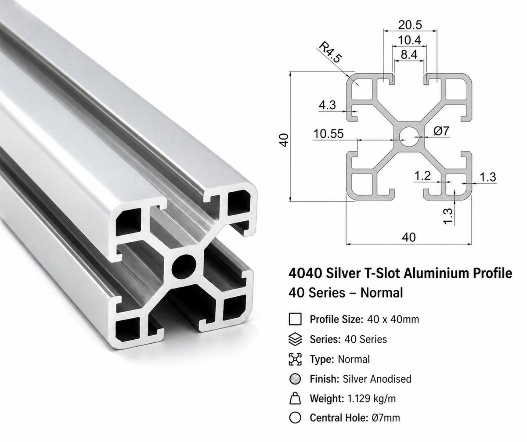Modular
aluminium profiles connected using brackets, bolts and T-nuts.

<strong>Pros</strong>: Highly adjustable, lightweight,
corrosion-resistant, easy to assemble and modify without welding.

<strong>Cons</strong>: More expensive than basic steel tubing in raw
material cost, and bolted joints can loosen or flex if inadequately
designed.

<ol start="2" type="1">
<li>
Welded steel square tubing
</li>
</ol>

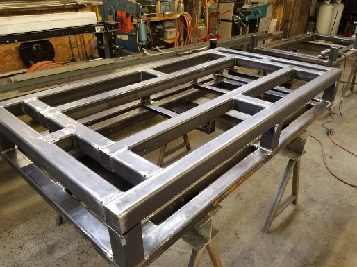Steel
hollow sections joined through welding to form a permanent frame.

<strong>Pros</strong>: High stiffness, strong rigid joints,
relatively inexpensive raw material and good durability.

<strong>Cons</strong>: Heavy, requires welding equipment and
expertise, difficult to modify after fabrication and requires corrosion
protection.

<ol start="3" type="1">
<li>
Aluminium square tubing / fabricated frame
</li>
</ol>

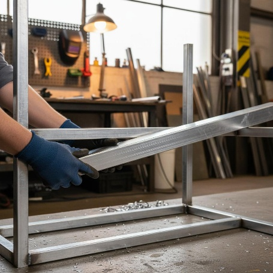Aluminium
hollow sections joined by welding or custom mechanical connections.

<strong>Pros</strong>: Lightweight, corrosion-resistant, potentially
lower material cost than T-slot extrusion and flexible frame
geometry.

<strong>Cons</strong>: Requires more fabrication, aluminium welding
can be challenging, and custom brackets or joints increase manufacturing
complexity.

<blockquote>

<strong><u>Systematic comparison of frame concepts</u></strong>

Following the investigation of the three proposed frame materials, a
weighted decision matrix was developed to systematically evaluate their
suitability for the FSAE race car simulator. Each concept was evaluated
using a scoring scale from 1 to 5, where 1 represents poor performance
and 5 represents excellent performance.

</blockquote>
<table class="data-table">
<colgroup>
<col style="width: 41%"/>
<col style="width: 14%"/>
<col style="width: 13%"/>
<col style="width: 11%"/>
<col style="width: 18%"/>
</colgroup>
<thead>
<tr class="header">
<th><strong>Criteria</strong></th>
<th><strong>Weight</strong></th>
<th><strong>T-Slot</strong></th>
<th><strong>Steel</strong></th>
<th><strong>Aluminum</strong></th>
</tr>
</thead>
<tbody>
<tr class="odd">
<td>Adjustability</td>
<td>25%</td>
<td>5</td>
<td>2</td>
<td>3</td>
</tr>
<tr class="even">
<td>Structural Rigidity</td>
<td>25%</td>
<td>4</td>
<td>5</td>
<td>4</td>
</tr>
<tr class="odd">
<td>Mass</td>
<td>20%</td>
<td>5</td>
<td>2</td>
<td>4</td>
</tr>
<tr class="even">
<td>Manufacturing and Assembly</td>
<td>15%</td>
<td>5</td>
<td>3</td>
<td>3</td>
</tr>
<tr class="odd">
<td>Joint Reliability</td>
<td>15%</td>
<td>3</td>
<td>5</td>
<td>4</td>
</tr>
<tr class="even">
<td><strong>Weighted Score</strong></td>
<td><strong>100%</strong></td>
<td><strong>4.45</strong></td>
<td><strong>3.40</strong></td>
<td><strong>3.60</strong></td>
</tr>
</tbody>
</table>

Table E: Weighted
Decision Matrix for Frame Material Selection

<blockquote>

Therefore, aluminium T-slot extrusion was selected as the preferred
frame material, as it provides the most suitable balance between
adjustability, structural performance, weight, and ease of assembly for
the proposed simulator.

</blockquote>
<h2 class="section-heading" id="concept-design">Concept Design</h2>

<em>Prepared by: Harith Raiyan, Abdul Haseeb, Neo Wei Yang</em>

<blockquote>

Figure 13 presents the proposed FSAE simulator frame, designed to
support the seat, steering system and pedal assembly while replicating
the low driving posture of an FSAE race car. The design prioritises
structural rigidity, adjustability and modularity, allowing components
to be repositioned or replaced. The elongated frame accommodates
longitudinal adjustments, while the lower structure considers future
integration with the existing motion platform.

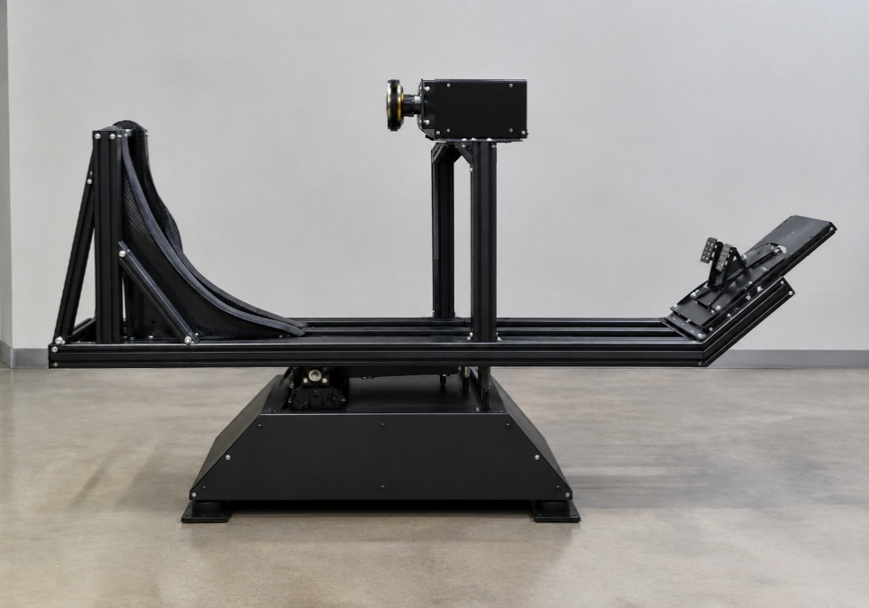

</blockquote>

Figure 13: Concept
Design for our FSAE Race Car Simulator

<h1 class="chapter" id="cad-modelling-and-design-development">CAD Modelling and Design
Development</h1>
<blockquote>

Following the development of the initial concept, the proposed FSAE
race car simulator will be modelled using SolidWorks to translate the
conceptual design into a detailed three-dimensional assembly.

The simulator frame is designed to accommodate the various components
required to replicate the FSAE cockpit, while ensuring structural
rigidity, adjustability and ease of assembly.

<strong><u>Key Components</u></strong>

</blockquote>
<table class="data-table">
<colgroup>
<col style="width: 32%"/>
<col style="width: 67%"/>
</colgroup>
<thead>
<tr class="header">
<th><strong>Component</strong></th>
<th><strong>Design Considerations</strong></th>
</tr>
</thead>
<tbody>
<tr class="odd">
<td>Steering Wheel</td>
<td>Rigid mounting with adjustable reach and 0°–60° tilt</td>
</tr>
<tr class="even">
<td>Pedal Box</td>
<td>Adjustable positioning with secure mounting under braking loads</td>
</tr>
<tr class="odd">
<td>Seat</td>
<td>Low FSAE seating position/Replicate exact seat</td>
</tr>
<tr class="even">
<td>Headrest</td>
<td>Rigid support positioned appropriately behind the driver's head</td>
</tr>
<tr class="odd">
<td>Harness</td>
<td>Secure mounting points with suitable belt angles and load paths</td>
</tr>
</tbody>
</table>

Table F: Key
Components and their Design Considerations

<h2 class="section-heading" id="frame-cad-design">Frame CAD Design</h2>

<em>Prepared by: Harith Raiyan</em>

<blockquote>

The initial frame assembly was developed using SolidWorks, consisting
of two longitudinal aluminium T-slot extrusions connected by transverse
crossmembers. Its modular design facilitates assembly, component
adjustment and future modifications, while additional crossmembers
provide mounting support for the seat, steering system and pedal
assembly.

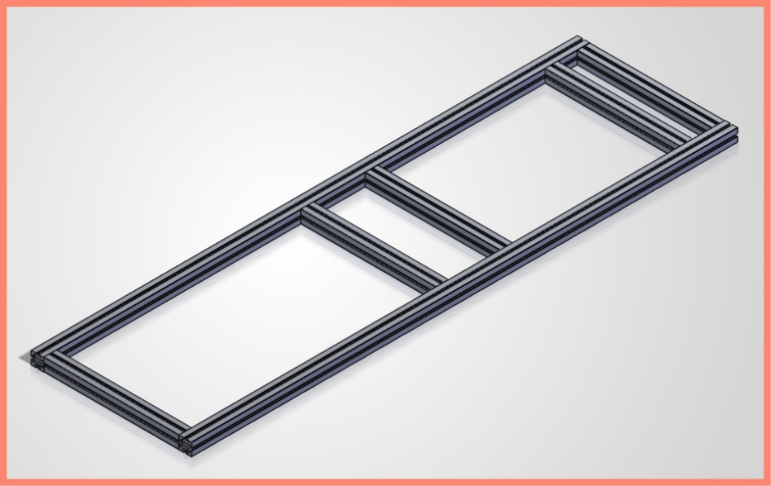

</blockquote>

Figure 14: Isometric
View of the Initial FSAE Simulator Frame CAD Assembly

<blockquote>

<strong><u>Design Considerations</u></strong>

The simulator frame is designed to provide sufficient structural
stiffness under steering and braking loads while maintaining a
lightweight and modular structure. Accessible mounting points are
incorporated to accommodate various components and allow future
adjustments. Additionally, the frame's dimensions and weight
distribution are considered to support potential integration with the
existing DOF Reality motion platform.

</blockquote>
<h2 class="section-heading" id="steering-system-cad-development">Steering System CAD
Development</h2>

<em>Prepared by: Harith Raiyan</em>

<blockquote>

<strong><u>Steering Support Structure</u></strong>

The steering support consists of two vertical 450 mm aluminium T-slot
extrusions connected by a 420 mm horizontal crossmember, using 40 × 40
mm profiles. This arrangement provides rigid support for the steering
wheelbase while distributing loads across the chassis. The modular
design also allows horizontal repositioning of the steering assembly to
accommodate different driver ergonomics and future adjustments.

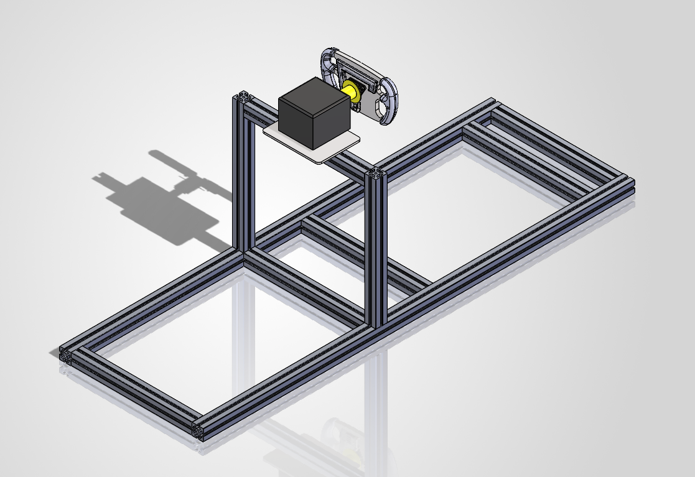

</blockquote>

Figure 15: Isometric
View of the Integrated Steering System and Simulator Frame

<blockquote>

<strong><u>Steering Wheelbase and Mounting Plate</u></strong>

A mounting plate was designed to provide an interface between the
steering wheelbase and the aluminium support structure. The plate
measures 200 × 150 mm with a thickness of 6 mm and is positioned
centrally on the horizontal crossmember.

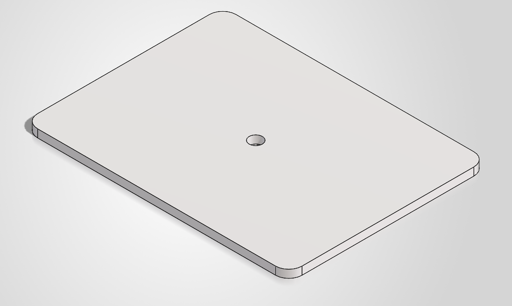

</blockquote>

Figure 16: CAD Model
of the Steering Wheel Mounting Plate

<blockquote>

<strong><u>Steering System Integration</u></strong>

The steering support and mounting plate were integrated into the main
simulator frame using SolidWorks assembly features. The assembly was
positioned to establish the preliminary steering wheel location relative
to the chassis.

The use of standardised T-slot profiles allows the steering support
to be repositioned along the frame without requiring major structural
modifications. This provides flexibility for subsequent ergonomic
adjustments and integration with the seat and pedal assemblies.

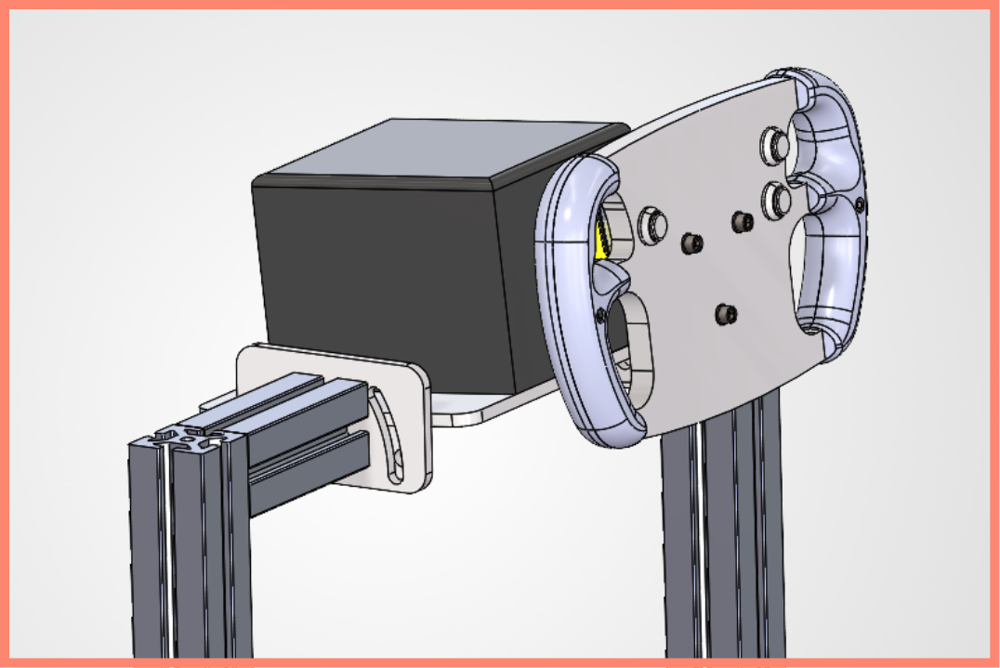

</blockquote>

Figure 17: Close-up
CAD model of the steering wheel

<blockquote>

<strong><u>Design Challenges</u></strong>

The steering system presents several design challenges, particularly
in balancing adjustability and structural rigidity to ensure the
mounting remains stable under steering loads. Additionally, T-slot
connections may experience loosening under repeated loading and
vibration. The steering assembly must also maintain realistic FSAE
cockpit geometry while providing sufficient knee and leg clearance for
the driver.

</blockquote>
<h2 class="section-heading" id="pedal-assembly-cad-development">Pedal Assembly CAD
Development</h2>

<em>Prepared by: Abdul Haseeb, Harith Raiyan</em>

<blockquote>

The pedal assembly was developed to replicate the low driving posture
of the FSAE race car while accommodating drivers of different leg
lengths. An adjustable mounting mechanism was incorporated to allow the
pedal position to be modified, while the supporting structure was
designed to withstand braking forces. The modular arrangement also
allows future modifications and integration with the main simulator
frame.

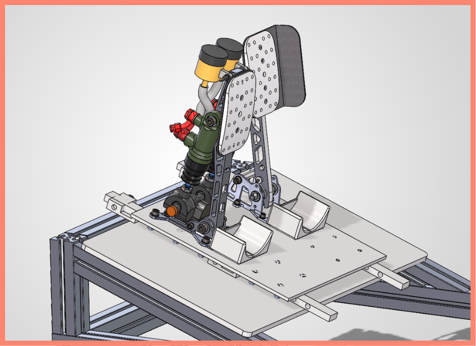

</blockquote>

Figure 18: Close up
CAD model view of pedal box

<blockquote>

<strong><u>Design Challenges</u></strong>

Several design challenges were identified, including preventing
unwanted movement under braking loads, maintaining alignment during
adjustment, achieving realistic brake response and ensuring sufficient
clearance between the pedal assembly and surrounding frame.

</blockquote>
<h2 class="section-heading" id="seat-and-harness-cad-development">Seat and Harness CAD
Development</h2>

<em>Prepared by: Neo Wei Yang, Harith Raiyan</em>

<blockquote>

The seat and harness assembly was developed to replicate the seating
position and configuration of the actual FSAE race car. A supporting
structure was designed using aluminium T-slot extrusions to securely
mount the seat and maintain structural rigidity during simulator
operation. A headrest was also incorporated to better represent the
actual racing seat configuration.

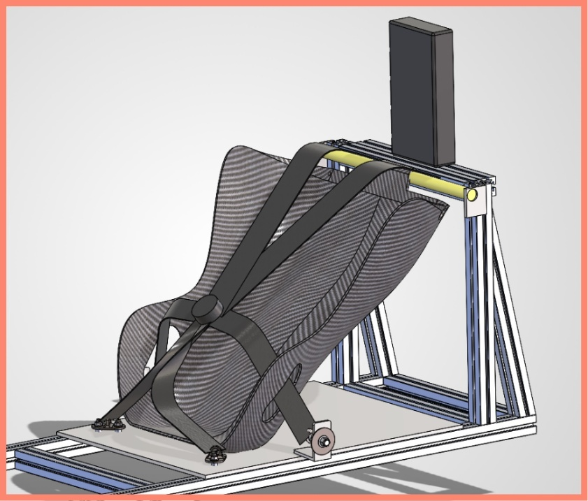

</blockquote>

Figure 19: Close up
CAD model view of seat structure

<blockquote>

<u>Harness Reinforcements</u>

The harness mounting system incorporates dedicated attachment points
connected to the simulator frame. L-brackets and reinforced mounting
arrangements were considered to provide secure connections while
accommodating the required harness geometry. The design prioritises
driver ergonomics, structural stability and compatibility with the
overall simulator frame.

</blockquote>

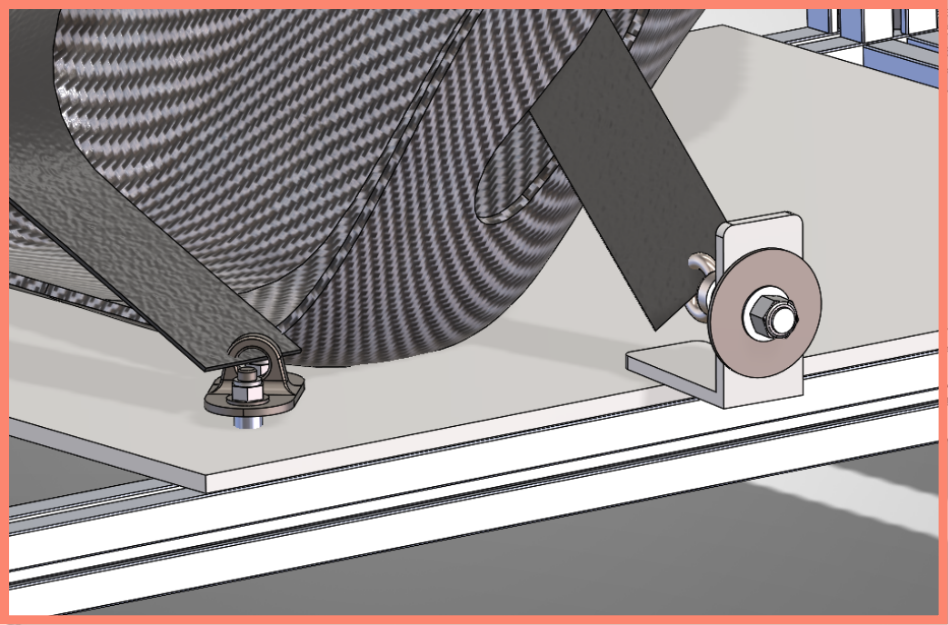

Figure 20: Close up
CAD model view of harness reinforcements

<h2 class="section-heading" id="complete-simulator-assembly">Complete Simulator Assembly</h2>

<em>Prepared by: Harith Raiyan</em>

<blockquote>

The complete FSAE simulator CAD assembly integrates the aluminium
T-slot frame, steering system, adjustable pedal assembly, seat, harness
and headrest into a modular structure. The design allows assessment of
component positioning, mounting compatibility and overall integration
while prioritising structural rigidity, driver adjustability and
realistic FSAE cockpit geometry.

</blockquote>

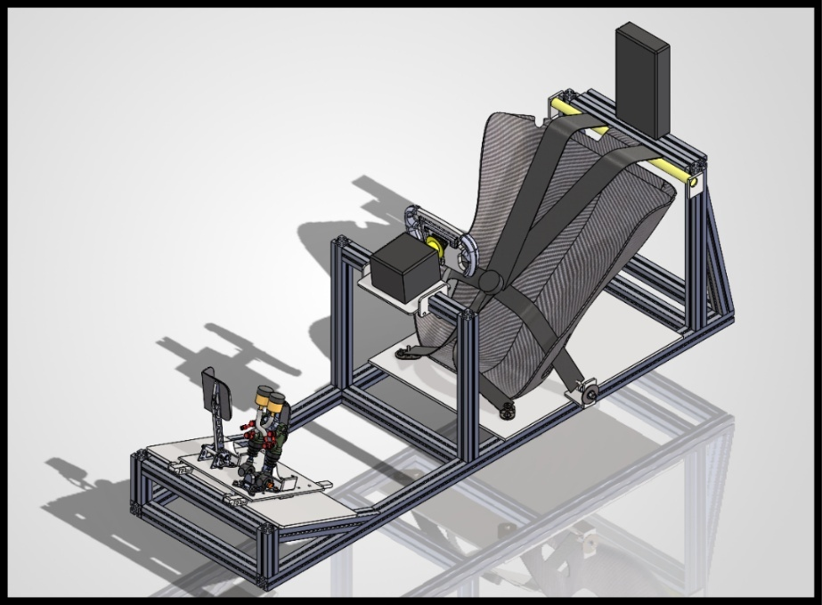

Figure 21: Isometric
view of FSAE Race Car Simulator CAD

<blockquote>

A human model was incorporated in Figure 22 to assess the simulator's
driving position and ergonomics, including seating posture, steering
reach, pedal accessibility and driver clearance. This provides a
preliminary evaluation of the FSAE driving geometry, with further
validation planned through dimensional comparisons with the actual race
car and physical fitment tests involving drivers of different body
sizes.

</blockquote>

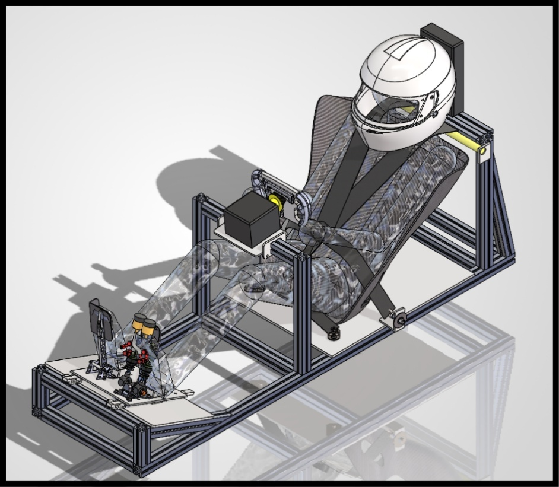

Figure 22: Isometric
view of FSAE Race Car Simulator CAD with human

<h1 class="chapter" id="cad-engineering-validation-and-testing">CAD Engineering
Validation and Testing </h1>
<h2 class="section-heading" id="axial-pushpull-force-simulation-analysis">Axial Push/Pull Force
Simulation Analysis</h2>

<em>Prepared by: Abdul Haseeb</em>

<blockquote>

A preliminary static Finite Element Analysis (FEA) was conducted
using SolidWorks Simulation to evaluate the steering support under axial
push and pull loads of 660 N applied at the steering-wheel mounting
location. This conservative load represents an abnormal but foreseeable
scenario where a driver may use the steering wheel for support when
entering, exiting or repositioning within the simulator, rather than
during normal steering operation.

Under axial push loading, the analysis recorded a maximum von Mises
stress of 43.76MPa. The highest stresses occurred mainly around the
adjustable mounting brackets and their connecting regions, while the
central mounting block and horizontal members experienced comparatively
lower stress. Using the Aluminum 6061-T6 yield strength of 276 MPa, the
theoretical factor of safety was calculated as:

</blockquote>

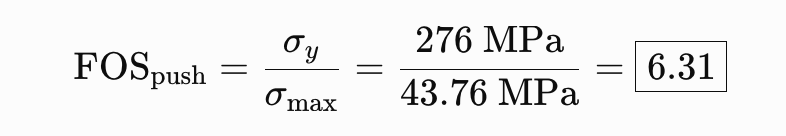

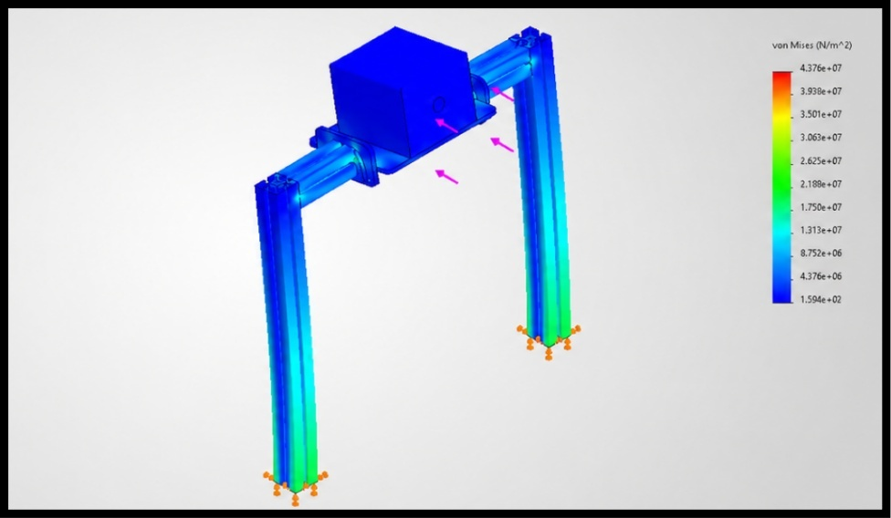

Figure 23: Axial Push
Force Simulation Analysis on steering wheel structure

<blockquote>

Therefore, yielding is not expected under the simulated load.

</blockquote>
<h2 class="section-heading" id="axial-pushpull-force-simulation-analysis-1">Axial Push/Pull
Force Simulation Analysis</h2>
<blockquote>

Under axial pull loading, the analysis recorded a maximum von Mises
stress of 44.01 MPa. Stress concentrations were similarly observed
around the adjustable mounting brackets and their connecting regions,
while the central mounting block and horizontal members experienced
comparatively lower stress. The theoretical factor of safety was
calculated as:

</blockquote>

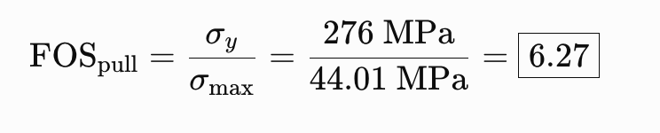

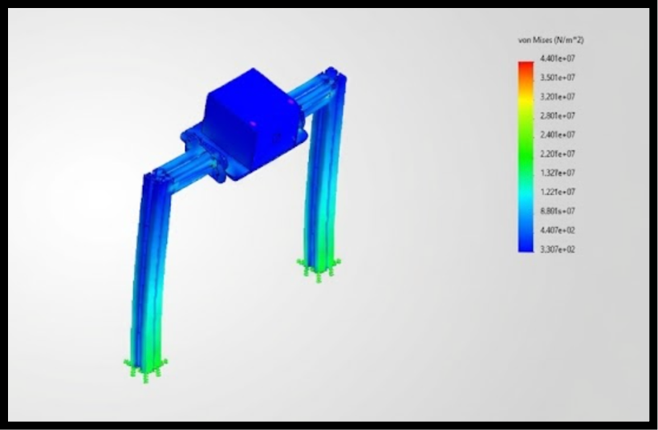

Figure : Axial Pull
Force Simulation Analysis on steering wheel structure

<blockquote>

The pull case was therefore marginally more critical than the push
case, although yielding is not expected.

</blockquote>
<h2 class="section-heading" id="torsion-stress-simulation-analysis">Torsion Stress Simulation
Analysis </h2>

<em>Prepared by: Harith Raiyan</em>

<blockquote>

A preliminary static Finite Element Analysis (FEA) was conducted
using SolidWorks Simulation to evaluate the steering support under
torsional loading. The analysis recorded a maximum von Mises stress of
2.697 MPa, with stress concentrations occurring mainly near the
adjustable mounting brackets. The steering mounting plate and horizontal
T-slot crossmember experienced relatively low stresses.

The brackets were modelled using Aluminium 6061-T6, with an
approximate yield strength of 276 MPa. The theoretical factor of safety
against yielding was calculated as:

$$FOS = \ \frac{\sigma_{y}}{\sigma_{\max}}
= \ \frac{276}{2.697} = 102.3$$

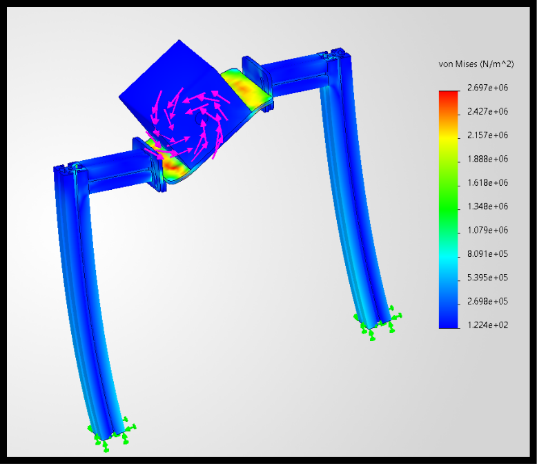

</blockquote>

Figure 25: Torsion
Simulation Analysis on steering wheel structure

<blockquote>

This indicates a substantial margin against yielding under the
simulated conditions. However, further analysis and physical testing are
required to validate joint reliability, deformation and overall
structural performance.

</blockquote>
<h1 class="chapter" id="future-work">Future Work</h1>
<h2 class="section-heading" id="future-testing">Future Testing</h2>
<blockquote>

Further testing will be conducted to evaluate the simulator's
structural reliability and ergonomic performance. Pedal and seat load
testing will assess the rigidity and stability of component mounting
points, while joint reliability testing will investigate potential
loosening of T-slot connections under repeated loading and vibration.
Additionally, ergonomic validation will compare the simulator's driving
position and adjustability with the actual FSAE race car to ensure
realistic driver accommodation.

</blockquote>
<h2 class="section-heading" id="project-timeline">Project Timeline</h2>
<blockquote>

Table G presents the proposed project timeline from November 2026 to
April 2027.

</blockquote>
<table class="data-table">
<colgroup>
<col style="width: 28%"/>
<col style="width: 12%"/>
<col style="width: 12%"/>
<col style="width: 12%"/>
<col style="width: 12%"/>
<col style="width: 12%"/>
<col style="width: 11%"/>
</colgroup>
<thead>
<tr class="header">
<th><strong>Project Activity</strong></th>
<th><strong>Nov ’26</strong></th>
<th><strong>Dec ’26</strong></th>
<th><strong>Jan ’27</strong></th>
<th><strong>Feb ’27</strong></th>
<th><strong>Mar ’27</strong></th>
<th><strong>Apr ’27</strong></th>
</tr>
</thead>
<tbody>
<tr class="odd">
<td>Finalised CAD &amp; Specifications</td>
<td></td>
<td></td>
<td></td>
<td></td>
<td></td>
<td></td>
</tr>
<tr class="even">
<td>Engineering Analysis</td>
<td></td>
<td></td>
<td></td>
<td></td>
<td></td>
<td></td>
</tr>
<tr class="odd">
<td>Fabrication &amp; Assembly</td>
<td></td>
<td></td>
<td></td>
<td></td>
<td></td>
<td></td>
</tr>
<tr class="even">
<td>Testing &amp; Validation</td>
<td></td>
<td></td>
<td></td>
<td></td>
<td></td>
<td></td>
</tr>
<tr class="odd">
<td>Motion-rig Integration</td>
<td></td>
<td></td>
<td></td>
<td></td>
<td></td>
<td></td>
</tr>
</tbody>
</table>

Table G: Project
Timeline

</body></article>
<footer>CDE4301 · NUS Formula SAE · Interim project documentation</footer></body></html>
